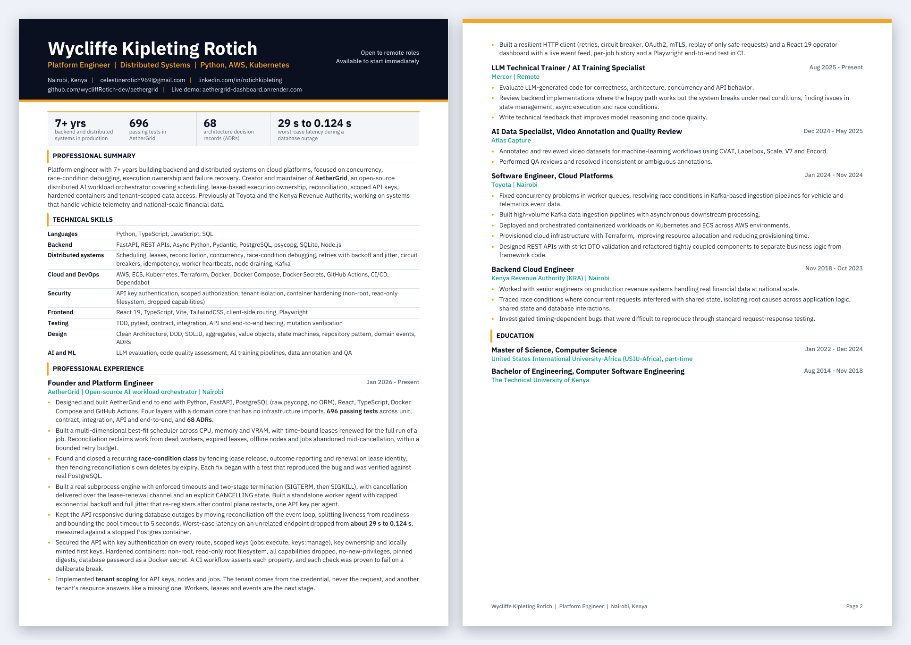

# Wycliffe Kipleting Rotich

**Platform Engineer | Distributed Systems | Python, AWS, Kubernetes**

Nairobi, Kenya (UTC+3) &nbsp;|&nbsp; Open to remote roles &nbsp;|&nbsp; Available to start immediately

## About

I build backend and distributed systems where concurrency failures cost real money. Seven-plus years across the Kenya Revenue Authority (national-scale revenue systems) and Toyota (cloud platforms for vehicle telematics), now building AetherGrid, an open-source orchestrator for AI workloads.

My focus: **concurrency, race-condition debugging, execution ownership and failure recovery.**

## Featured project: AetherGrid

An open-source control plane that schedules AI workloads across compute nodes, guarantees exclusive execution ownership under failure, and gives operators one authenticated console.

| | |
|---|---|
| **Correctness** | Time-bound leases, fenced on lease identity, so a stale worker can never overwrite the worker that replaced it |
| **Scheduling** | Best-fit placement across CPU, memory and VRAM, with node draining |
| **Resilience** | Reconciliation of dead workers and expired leases. Outage latency on an unrelated endpoint cut from about 29 s to 0.124 s |
| **Security** | Scoped API keys, tenant-scoped data access, hardened containers (non-root, read-only filesystem, dropped capabilities) checked in CI |
| **Rigor** | 68 architecture decision records, with a test written before every fix |

[Code](https://github.com/wycliffRotich-dev/aethergrid) &nbsp;|&nbsp; [Live dashboard](https://aethergrid-dashboard.onrender.com/)

## Stack

## Experience at a glance

| Period | Role | Where |
|---|---|---|
| 2026 to now | Founder and Platform Engineer | AetherGrid (open source) |
| 2025 to now | LLM Technical Trainer | Mercor |
| 2024 | Software Engineer, Cloud Platforms | Toyota |
| 2018 to 2023 | Backend Cloud Engineer | Kenya Revenue Authority |

**Education:** MSc Computer Science, USIU-Africa (2022 to 2024). BEng Computer Software Engineering, Technical University of Kenya (2018).

## Contact

Email [celestinerotich969@gmail.com](mailto:celestinerotich969@gmail.com) or message me on [LinkedIn](https://www.linkedin.com/in/rotichkipleting/).
